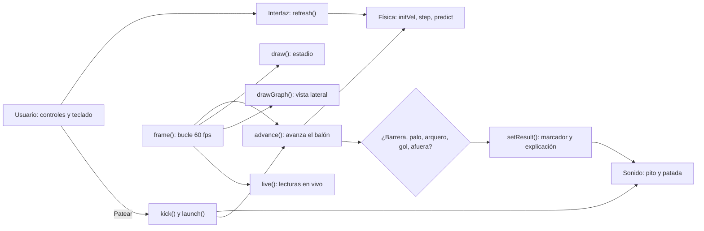
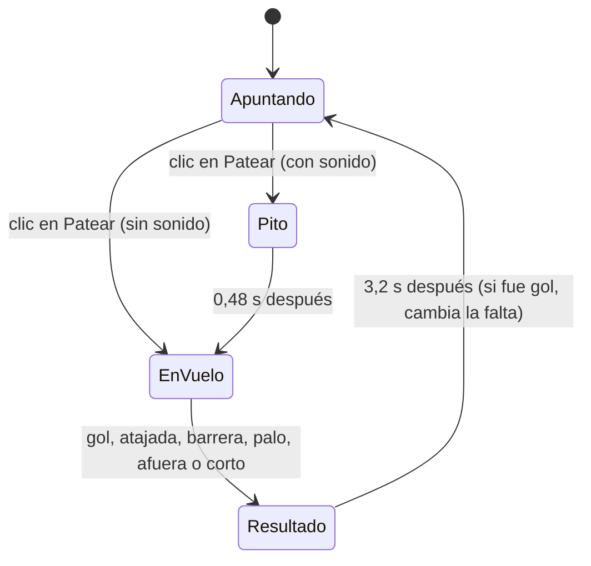

# ⚽ Tiro Libre Parabólico
### Proyecto de aula · Feria de Física · Tema: **Movimiento parabólico (tiro de proyectiles)**

> Un juego de tiros libres de fútbol en el que, para meter gol, hay que **usar la física**: escoger el ángulo, la velocidad, la dirección y el efecto del balón para pasar por encima de la barrera, meterlo por debajo del travesaño y ganarle al arquero.

---

## 1. Resumen

*Tiro Libre Parabólico* es una simulación interactiva hecha en **un solo archivo (`index.html`)** con HTML, CSS y JavaScript puro. Se abre con doble clic en cualquier navegador, **no necesita internet ni instalar nada**.

El jugador ajusta cuatro valores (ángulo θ, velocidad v₀, dirección y efecto) y patea. El programa calcula la trayectoria del balón **60 veces por segundo con las leyes de la física** (gravedad, resistencia del aire y efecto Magnus), la dibuja en un estadio en perspectiva 3D, la grafica en una vista lateral y al final **explica por qué fue gol o por qué falló**.

## 2. Objetivos

**Objetivo general:** explicar el movimiento parabólico de forma práctica y divertida usando una situación real y conocida: el tiro libre en el fútbol.

**Objetivos específicos:**
1. Mostrar que un lanzamiento se puede **descomponer** en un movimiento horizontal (velocidad constante) y uno vertical (acelerado por la gravedad).
2. Calcular y comparar con el juego: **altura máxima, tiempo de vuelo, alcance y altura a cierta distancia**.
3. Comprobar cómo cambia la trayectoria cuando cambia la **gravedad** (Tierra, Marte, Luna).
4. Mostrar la diferencia entre el **modelo ideal** (sin aire) y la **realidad** (con aire y efecto).

## 3. Justificación: ¿por qué un tiro libre?

Un tiro libre es un problema de proyectiles con **restricciones reales**:

| Restricción | Medida real (reglamento FIFA) | Qué exige del tiro |
|---|---|---|
| Barrera | a **9,15 m** del balón, **1,85 m** de alto (y salta) | El balón debe ir **alto** al pasar por ahí |
| Travesaño | **2,44 m** de alto | El balón debe ir **bajo** al llegar al arco |
| Ancho del arco | **7,32 m** | Hay que **apuntar** bien |
| Arquero | reacciona en ~0,3–0,5 s | Hay que patear **rápido** y lejos de él |

Subir mucho para pasar la barrera hace que el balón se pase del travesaño; patear bajo hace que choque con la barrera. **La única forma de ganar es entender la parábola.**

---

## 4. Marco teórico

### 4.1 Descomposición de la velocidad
Cuando el balón sale con rapidez **v₀** y ángulo **θ** sobre el piso:

```
vx = v0 · cos θ     (horizontal: constante si no hay aire)
vy = v0 · sen θ     (vertical: la gravedad la va frenando)
```

### 4.2 Ecuaciones de movimiento (sin aire)
```
x(t) = vx · t
y(t) = vy · t − ½ · g · t²
```
Horizontalmente es un **MRU**; verticalmente es un **MRUA** con aceleración −g. La combinación de los dos da una **parábola**.

### 4.3 Fórmulas que muestra el juego

| Magnitud | Fórmula | De dónde sale |
|---|---|---|
| Altura máxima | `h = vy² / (2g)` | En el punto más alto vy = 0 → vy² = 2·g·h |
| Tiempo de vuelo | `t = 2·vy / g` | y(t) = 0 → t·(vy − ½·g·t) = 0 |
| Alcance | `R = v0² · sen(2θ) / g` | R = vx·t = v0·cosθ · 2·v0·senθ / g y 2·senθ·cosθ = sen 2θ |
| Altura a una distancia L | `y = L·tanθ − g·L² / (2·v0²·cos²θ)` | Se despeja t = L / vx y se reemplaza en y(t) |

La última es la **ecuación de la trayectoria**: con ella el juego calcula la altura del balón **al pasar la barrera (L = 9,15 m)** y **al llegar al arco**.

### 4.4 Ejemplo resuelto (valores iniciales del juego)
θ = 20°, v₀ = 22 m/s, g = 9,81 m/s², arco a L = 22,2 m:

- vx = 22 · cos 20° = **20,67 m/s** · vy = 22 · sen 20° = **7,52 m/s**
- h = 7,52² / (2·9,81) = **2,88 m**
- t = 2·7,52 / 9,81 = **1,53 s**
- R = 22² · sen 40° / 9,81 = **31,7 m**
- Altura en la barrera: 9,15·tan20° − 9,81·9,15² / (2·20,67²) = **2,37 m** → pasa la barrera (1,85 m) ✔
- Altura en el arco: 22,2·tan20° − 9,81·22,2² / (2·20,67²) = **2,42 m** → justo por debajo del travesaño (2,44 m) ✔

Son los mismos números que aparecen en la tabla del juego.

### 4.5 Lo que el modelo ideal no cuenta (y el juego sí)

**Resistencia del aire.** El aire frena al balón con una fuerza proporcional al cuadrado de la rapidez:
```
a_aire = −k · |v| · v        con   k = ½ · ρ · Cd · A / m
```
Con ρ = 1,2 kg/m³ (aire), Cd ≈ 0,25, A = π·(0,11 m)² y m = 0,43 kg, sale **k ≈ 0,0133 m⁻¹**, que es justo el número que usa el código. Por eso el balón real **llega un poco más bajo y más corto** que lo que dicen las fórmulas.

**Efecto Magnus.** Un balón que gira arrastra el aire de un lado y lo frena del otro; la diferencia de presión lo empuja **de lado**. Es la "comba" de los tiros libres. En el juego es una aceleración **perpendicular a la velocidad** y proporcional al giro y a la rapidez. **Sin aire no hay efecto Magnus**, por eso el control de efecto se desactiva en la Luna y en "Sin aire".

**Otros lugares:**

| Lugar | g (m/s²) | Aire | Qué se observa |
|---|---|---|---|
| Tierra | 9,81 | Sí | Tiro realista, con frenado y comba |
| Tierra sin aire | 9,81 | No | Parábola perfecta: el juego coincide con las fórmulas |
| Marte | 3,71 | Casi nada | El balón vuela ~2,6 veces más alto y lejos |
| Luna | 1,62 | No | Tiros altísimos y lentos |

---

## 5. Tecnologías usadas

| Tecnología | Para qué se usa |
|---|---|
| **HTML5** | Estructura de la página: marcador, controles, tabla de fórmulas |
| **CSS3** | Diseño oscuro tipo estadio nocturno, distribución que se adapta a celular y portátil (Grid, Flexbox, media queries) |
| **JavaScript (puro)** | Toda la lógica: física, detección de choques, arquero, interfaz |
| **Canvas 2D** | Dibujo del estadio en perspectiva 3D y de la gráfica lateral |
| **Web Audio API** | Sonidos generados por código (patada, pito, golpes, tribuna, grito de gol). No hay archivos de audio |
| **localStorage** | Guardar el récord y la preferencia de sonido en el navegador |
| Google Fonts (opcional) | Tipografías Anton y Barlow. Sin internet se usan fuentes del sistema |

**¿Por qué sin librerías ni frameworks?** Para que funcione en **cualquier computador de la feria, sin internet y sin instalar nada**, y para que **todo el código sea nuestro** y lo podamos explicar línea por línea.

---

## 6. Arquitectura del programa

### 6.1 Un solo archivo, tres capas
```
index.html
├── <style>   → Apariencia (CSS)
├── <body>    → Estructura (HTML): encabezado, guía, estadio, controles, laboratorio
└── <script>  → Comportamiento (JavaScript), dividido en 11 secciones numeradas
```

### 6.2 Secciones del JavaScript

| # | Sección | Qué contiene |
|---|---|---|
| 1 | Utilidades | `$()` para buscar elementos, `fmt()` para escribir números con coma |
| 2 | Medidas reales | Radio del balón, arco, barrera, lugares (g y aire), arquero |
| 3 | Estado del juego | Variables que cambian: posición de la falta, balón, marcador |
| 4 | Escena y cámara | `setup()`, `proj()`: convierte puntos 3D en puntos de pantalla |
| 5 | **Física** | `env()`, `initVel()`, `step()`, `predict()`, `keeperX()` |
| 6 | Sonido | Módulo `Sonido` con la Web Audio API |
| 7 | Flujo del tiro | `kick()`, `launch()`, `advance()`, `setResult()`, `reset()` |
| 8 | Dibujo | `draw()`, `player()`, `drawBall()` |
| 9 | Gráfica | `drawGraph()`: altura contra distancia |
| 10 | Interfaz | `refresh()`, `live()`, teclado y botones |
| 11 | Bucle principal | `frame()`: se repite ~60 veces por segundo |

### 6.3 Diagrama de módulos


### 6.4 Estados del juego


### 6.5 ¿Cómo se mueve el balón? (el corazón del programa)
El computador no usa la fórmula de la parábola para mover el balón: **la construye paso a paso**. Cada **1/240 de segundo** hace esto (función `step`):

1. Calcula la aceleración: gravedad (−g hacia abajo) + frenado del aire + empuje lateral del efecto.
2. Actualiza la velocidad: `v = v + a · dt`
3. Actualiza la posición: `p = p + v · dt`

Esto se llama **integración numérica (método de Euler)**. Sin aire, el resultado es prácticamente igual a la fórmula ideal; con aire, el computador resuelve un problema que **no tiene fórmula sencilla**. Esa es la ventaja de simular.

La **trayectoria prevista** (puntos amarillos) se obtiene con `predict()`, que hace la misma simulación "en secreto" antes de patear.

### 6.6 Funciones principales

| Función | Qué hace, en palabras sencillas |
|---|---|
| `setup()` | Ubica la falta, la cámara, la barrera y el arquero |
| `initVel()` | Convierte ángulo, velocidad y dirección en vx, vy, vz |
| `step()` | Avanza la física 1/240 s (gravedad + aire + Magnus) |
| `predict()` | Simula el tiro antes de patear para dibujar la guía |
| `keeperX()` | Mueve al arquero después de su tiempo de reacción |
| `kick()` / `launch()` | Pito del árbitro y remate |
| `advance()` | Avanza el tiro y detecta barrera, palos, atajada, gol o fuera |
| `setResult()` | Muestra el resultado, la explicación y actualiza el marcador |
| `draw()` | Dibuja el estadio en perspectiva |
| `drawGraph()` | Dibuja la vista lateral altura–distancia |
| `refresh()` | Actualiza los controles, las ayudas y la tabla de fórmulas |

---

## 7. La pantalla, parte por parte

1. **Encabezado:** título, marcador (nivel, goles, tiros, racha, récord), acceso a 🏆 Modo Reto, 🎖️ Top 10 y botón de sonido.
2. **¿Cómo se juega?:** 4 pasos intuitivos para el visitante con guía de ratón y teclado.
3. **Estadio 3D:**
   - Césped en perspectiva, tribuna interactiva con público y reflectores realistas.
   - Balón con halo pulsante interactivo: haz clic y arrastra directamente para apuntar.
   - Flecha curva en el piso proyectada en tiempo real según la dirección y el efecto Magnus.
   - Recuadro HUD en vivo: grados de elevación θ, velocidad inicial v₀, dirección y comba.
   - **🔬 Tarjeta de Diagnóstico en Pantalla:** tras el tiro muestra badge del resultado, desglose de las 3 fuerzas ($F_g, F_d, F_M$ en Newtons), explicación del suceso, consejos de mejora y fórmulas sustituidas.
4. **Tablero de mando:**
   - ① El remate: ángulo, velocidad, dirección y efecto Magnus con notas descriptivas.
   - ② Dónde se juega: Tierra, Sin aire, Marte, Luna.
   - ③ Arquero y modo: Progresión por niveles o Modo libre (Lento, Normal, Felino).
   - **Predicción física ideal:** aviso anticipado antes de patear sobre si el balón supera la barrera y entra al arco.
5. **Laboratorio de física:**
   - Gráfica lateral interactiva altura vs distancia (trayectoria ideal vs real ejecutada).
   - Lecturas en vivo: tiempo transcurrido, distancia horizontal recorrida, altura actual y rapidez.
   - Glosario de magnitudes y tabla de fórmulas ideales calculadas paso a paso.
6. **🔬 Informe Físico Permanente del Disparo:**
   - Balance de fuerzas en Newtons y aceleraciones vectoriales netas ($a_y, a_z$).
   - Comparativa directa entre el modelo ideal sin fricción y el tiro real simulado.
   - Guía de argumentación redactada para que el estudiante exponga con soltura ante el jurado.

---

## 8. Cómo usarlo

1. Abrir `index.html` con doble clic (en cualquier navegador: Chrome, Edge, Firefox, etc.).
2. **Apuntado directo con ratón / pantalla táctil:**
   - Haz clic sobre el balón y arrástralo hacia atrás o hacia los lados.
   - Observa en la esquina inferior izquierda del estadio el recuadro HUD que muestra en tiempo real los **grados de elevación θ, la velocidad inicial v₀, la dirección y el efecto Magnus**.
   - Suelta el clic para ejecutar el remate (o pulsa el botón **Patear Balón**).
3. **Modo Reto Feria:**
   - Pulsa el botón **🏆 Modo Reto**.
   - Ingresa el nombre del visitante.
   - Cuenta con **5 tiros** con bonificaciones:
     - +100 puntos por gol.
     - +50 puntos adicionales si se anota con efecto curvo (comba ≥ 25%).
     - +50 puntos adicionales si se anota desde más de 25 m.
   - Al terminar se registra automáticamente en el **🎖️ Top 10** guardado localmente.
4. **Teclado:** ← → dirección · ↑ ↓ ángulo · W / S velocidad · A / D efecto · Espacio patear · M sonido.

---

## 9. Guion para la sustentación (≈ 5 minutos)

1. **Pregunta de entrada (30 s):** "¿Qué tiene que pasar para que un tiro libre sea gol?" → pasar la barrera, bajar antes del travesaño, ganarle al arquero.
2. **La parábola (1 min):** mostrar en la tabla cómo v₀ se divide en vx y vy. Mover el ángulo y ver cómo cambian.
3. **Predicción vs realidad (1 min):** con los valores iniciales, la tabla dice que llega a 2,42 m (¡casi el travesaño!). Patear en "Tierra" y luego en "Sin aire": con aire el balón llega más bajo.
4. **Gravedad (1 min):** el mismo tiro en Marte y en la Luna se va muy por encima. Explicar con `h = vy² / 2g`: si g es 6 veces menor, la altura máxima es 6 veces mayor.
5. **Efecto Magnus (1 min):** curvar el balón alrededor de la barrera arrastrando con el ratón. Pasar a la Luna y mostrar que el control se apaga: sin aire no hay comba.
6. **Cierre (30 s):** "El computador no adivina: calcula la física 240 veces por segundo".

### Experimentos para el público
- **¿Qué ángulo da el máximo alcance?** Mirar el valor de R en la tabla: es máximo en **45°**.
- **Ángulos complementarios:** 30° y 60° dan el mismo alcance (sen 60° = sen 120°). En el juego se puede comparar 20° con 45° y ver alturas distintas.
- **Más velocidad, menos tiempo para el arquero:** patear igual a 20 y a 32 m/s con el arquero "Felino".

---

## 10. Preguntas que puede hacer el profesor

**¿El juego usa las fórmulas de la tabla para mover el balón?**
No. Las fórmulas son el **modelo ideal** y sirven para predecir. El balón se mueve con integración numérica paso a paso (`step`), que además incluye aire y efecto. En "Sin aire" ambos coinciden.

**¿Por qué el balón real llega más bajo que la fórmula?**
Porque el aire lo frena: pierde velocidad horizontal, tarda más en llegar y la gravedad tiene más tiempo para bajarlo.

**¿De dónde sale k = 0,0133?**
De `k = ½·ρ·Cd·A/m` con los datos de un balón reglamentario (ver sección 4.5).

**¿Por qué dt = 1/240 s?**
Un paso más pequeño da más precisión. 1/240 s es lo bastante pequeño para que el error sea de milímetros y lo bastante rápido para el computador.

**¿Las medidas son reales?**
Sí: arco 7,32 × 2,44 m, barrera a 9,15 m y 1,85 m de alto, balón de 0,11 m de radio. Todo en metros, segundos y m/s.

**¿Cómo se dibuja en 3D si el canvas es 2D?**
Con **proyección en perspectiva**: cada punto se divide por su distancia a la cámara (`proj()`). Lo lejano se ve más pequeño y más cerca del horizonte.

**¿Cómo "sabe" el arquero a dónde lanzarse?**
`predict()` calcula por dónde cruzará el balón la línea de gol. El arquero espera su tiempo de reacción y luego se mueve hacia ese punto con una rapidez máxima (`keeperX()`).

**¿De dónde salen las fuerzas en Newtons de la tarjeta de diagnóstico?**
- **Gravedad:** $F_g = m \cdot g = 0,43\text{ kg} \times 9,81\text{ m/s}^2 = 4,22\text{ N}$ (constante hacia abajo).
- **Arrastre:** $F_d = m \cdot k \cdot v^2$. Con $v = 22\text{ m/s}$, $F_d = 0,43 \times 0,0133 \times (22)^2 \approx 2,77\text{ N}$ (opuesta al vector velocidad).
- **Fuerza Magnus:** $F_M = m \cdot |cm| \cdot v^2$. Para $50\%$ de comba, $F_M \approx 1,38\text{ N}$ (perpendicular lateral).

**¿Qué principio físico produce el efecto Magnus?**
El **Principio de Bernoulli** en fluidodinámica. La rotación del balón arrastra el aire circundante: en un costado la velocidad relativa del aire aumenta y la presión estática disminuye ($P \downarrow$); en el costado opuesto la velocidad disminuye y la presión aumenta ($P \uparrow$). La diferencia de presiones ($\Delta P$) genera una fuerza neta perpendicular que curva la trayectoria hacia la zona de menor presión.

**¿Por qué la pantalla se pausa al terminar el remate?**
Para facilitar la **sustentación pedagógica** ante los profesores y jurados. Permite al expositor señalar la pantalla, mostrar las 3 fuerzas, leer por qué falló o entró y justificar los cálculos matemáticos sin que el juego se reinicie automáticamente. Se avanza cuando el expositor lo decida con la tecla `Espacio` o el botón `Siguiente tiro`.

---

## 11. Simplificaciones del modelo

- El balón es una esfera que no se deforma; el rebote en el piso es aproximado.
- El efecto Magnus es una aproximación proporcional al giro (el giro no disminuye con el tiempo).
- No hay viento.
- La barrera y el arquero tienen movimientos simplificados.
- Las fórmulas de la tabla toman el balón como un punto que sale desde el piso.

---

## 12. Bitácora de mejoras

| Paso | Mejora | Estado |
|---|---|---|
| 0 | Código organizado en secciones comentadas; interfaz explicativa (guía, ayudas en cada control, predicción con fórmulas, leyenda de la gráfica, valores de θ, v₀, g, L; fila "altura al pasar la barrera") | ✅ Hecho |
| 1 | **Sonido** con Web Audio API: patada, pito, golpe en barrera/palo, murmullo, grito de gol y botón de silencio | ✅ Hecho |
| 2 | **Niveles**: Nivel 1 cerca (18 m) con 3 jugadores y arquero lento. Cada 2 goles sube nivel (se aleja la falta, barrera hasta 6 jugadores y arquero más ágil). Modo libre disponible. | ✅ Hecho |
| 3 | **Modo Reto Feria & Control Táctil/Ratón**: Apuntado intuitivo arrastrando el balón con flecha curva en el piso, HUD interactivo en vivo con grados, velocidad y comba, interfaz ampliada, reto de 5 tiros y Top 10 con localStorage | ✅ Hecho |
| 4 | **Diagnóstico Físico y Análisis Post-Tiro**: Tarjeta en pantalla con desglose de fuerzas ($F_g, F_d, F_M$ en Newtons), causa física exacta, sugerencias de mejora, fórmulas aplicadas con valores sustituidos, pausa para explicar al jurado y reporte permanente de laboratorio | ✅ Hecho |

---

## 13. Guía del Diagnóstico Físico para la Feria

Al finalizar cada disparo, el simulador despliega un **análisis pedagógico inmediato**:
1. **Fuerzas Aplicadas**:
   - **Gravedad ($F_g = m \cdot g$)**: Fuerza vertical hacia abajo que curva la trayectoria en parábola ($4,22\text{ N}$ en la Tierra para balón FIFA de $0,43\text{ kg}$).
   - **Arrastre Aerodinámico ($F_d = \frac{1}{2} C_d \rho A v^2$)**: Fricción del aire opuesta al movimiento que frena y achata la curva real frente al modelo ideal.
   - **Fuerza Magnus ($F_M = S_0 (\vec{\omega} \times \vec{v})$)**: Desvío lateral originado por la diferencia de presión de Bernoulli entre ambos costados del balón con efecto.
2. **Diagnóstico del Suceso**: Detalla con precisión métrica la altura en la barrera a $9,15\text{ m}$, altura al cruzar la meta vs los $2,44\text{ m}$ del travesaño, tiempo de reacción del arquero o alcance horizontal.
3. **Recomendación de Mejora**: Consejos cuantitativos exactos sobre qué ángulo $\theta$, velocidad $v_0$ o efecto aplicar en el siguiente tiro.
4. **Fórmulas Sustituidas**: Desglose con los números reales del remate para que el expositor pueda sustentar matemáticamente la jugada ante los jurados.
5. **Control del Ritmo**: Botón de pausa activado por defecto para que el alumno pueda exponer con calma sin que la pantalla se reinicie sola, con avance instantáneo mediante la tecla `Espacio`.

---

## 13. Referencias

- Serway, R. & Jewett, J. *Física para ciencias e ingeniería*, Vol. 1 — Cap. "Movimiento en dos dimensiones".
- Halliday, D., Resnick, R. & Walker, J. *Fundamentos de Física* — Movimiento de proyectiles.
- FIFA / IFAB. *Reglas de juego* — Regla 1 (dimensiones del arco) y Regla 13 (tiros libres).
- NASA. *Planetary Fact Sheet* — valores de gravedad de la Luna, Marte y Júpiter.
- MDN Web Docs. *Canvas API* y *Web Audio API*.
